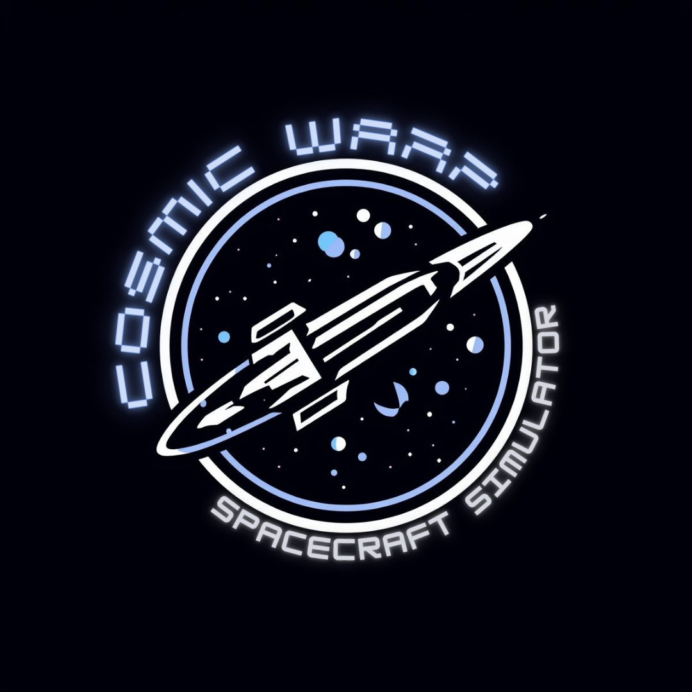
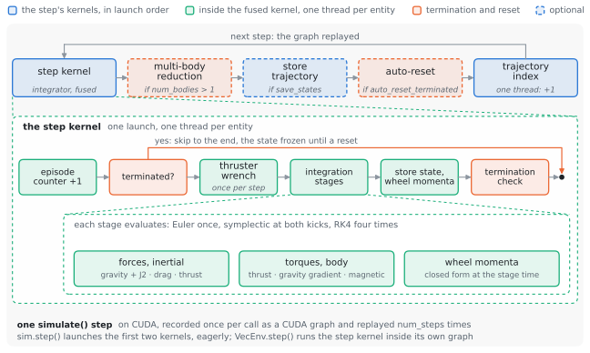
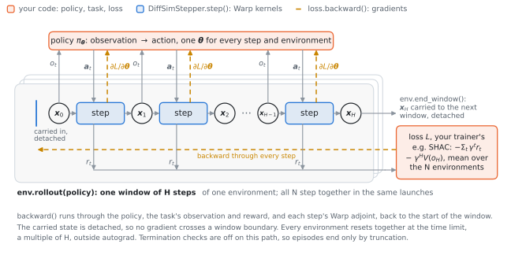

# COSMIC WARP

<p align="center"></p>

<p align="center">
<a href="https://github.com/Pedro-g-Lima/COSMIC_WARP/actions/workflows/tests.yml"></a>
<a href="https://pedro-g-lima.github.io/COSMIC_WARP/"></a>
<a href="https://pypi.org/project/cosmic-warp/"></a>

<a href="https://github.com/Pedro-g-Lima/COSMIC_WARP/blob/main/LICENSE"></a>
<a href="https://doi.org/10.5281/zenodo.23950779"></a>
</p>

GPU-parallel spacecraft dynamics on [NVIDIA Warp](https://github.com/NVIDIA/warp).
Thousands to millions of spacecraft — orbit and attitude in float64, with
thrusters, reaction wheels and environmental perturbations — step in
parallel, each `simulate()` loop replayed as one CUDA graph. For Monte Carlo
studies, gradient-based optimization and reinforcement learning.

COSMIC WARP is the simulator, not the application: guidance, control and
training algorithms are yours. The API may change before 1.0, never silently:
see [API stability](https://pedro-g-lima.github.io/COSMIC_WARP/reference/stability/)
and the [changelog](https://github.com/Pedro-g-Lima/COSMIC_WARP/blob/main/CHANGELOG.md).

**[Documentation](https://pedro-g-lima.github.io/COSMIC_WARP/)**: [Getting started](https://pedro-g-lima.github.io/COSMIC_WARP/getting-started/) ·
[Guides](https://pedro-g-lima.github.io/COSMIC_WARP/guides/) · [YAML reference](https://pedro-g-lima.github.io/COSMIC_WARP/guides/configuration/) ·
[Theory](https://pedro-g-lima.github.io/COSMIC_WARP/theory/) · [Validation](https://pedro-g-lima.github.io/COSMIC_WARP/validation/) ·
[API reference](https://pedro-g-lima.github.io/COSMIC_WARP/reference/api/cosmic_warp/) · [Roadmap](https://pedro-g-lima.github.io/COSMIC_WARP/roadmap/)

## Inside a step

<picture>
  <source media="(prefers-color-scheme: dark)" srcset="https://raw.githubusercontent.com/Pedro-g-Lima/COSMIC_WARP/main/docs/assets/step-dark.svg">
  
</picture>

## Features

- **6-DOF dynamics** with variable mass; Euler, RK4 (default) or symplectic
  kick–drift–kick.
- **Physics**: point-mass gravity, J2, atmospheric drag, gravity-gradient
  and magnetic torques, each switchable.
- **Actuators**: up to 8 thrusters and 4 reaction wheels per spacecraft.
- **Batches on the device**: one or several spacecraft per environment,
  sampled resets (boxes or orbital elements), domain randomization and
  termination, all inside the captured step.
- **Scenarios in YAML**, strictly checked.
- **Gradients** through the dynamics for initial states, controls and
  vehicle parameters.
- **Reinforcement learning**: a vectorized environment with zero-copy torch
  views, adapters for rsl_rl, skrl and rl_games, and a differentiable
  environment for first-order methods such as SHAC.
- **Validation**: every claim names the test that checks it, against
  analytic results where they exist
  ([validation](https://pedro-g-lima.github.io/COSMIC_WARP/validation/)).

**Performance**: 3.1 × 10⁸ env-steps/s — symplectic, float64, 16,384
environments, one RTX 4070 Ti SUPER
([benchmarks](https://pedro-g-lima.github.io/COSMIC_WARP/benchmarks/)).

## Learning through the dynamics

<picture>
  <source media="(prefers-color-scheme: dark)" srcset="https://raw.githubusercontent.com/Pedro-g-Lima/COSMIC_WARP/main/docs/assets/learning-dark.svg">
  
</picture>

## Install

Python 3.12 or newer. An NVIDIA GPU with CUDA is the target; everything also
runs on the CPU (`device="cpu"`).

```bash
pip install cosmic-warp
pip install "cosmic-warp[torch,skrl]"   # extras: torch, rsl-rl, skrl, rl-games, examples
```

The examples and tests live in the repository:

```bash
git clone https://github.com/Pedro-g-Lima/COSMIC_WARP.git
cd COSMIC_WARP
pip install -U pip                      # the dev group below needs pip 25.1
pip install -e ".[examples]"
```

An older system Python, CUDA checks and the extras are covered in
[Getting started](https://pedro-g-lima.github.io/COSMIC_WARP/getting-started/).

## Quick start

```python
from cosmic_warp.core.pipeline import SpacecraftSimulator

# 1000 spacecraft in low Earth orbit, drawn from the default reset bounds
sim = SpacecraftSimulator(num_envs=1000, integrator="rk4", dt=1.0)
sim.reset()

trajectory = sim.simulate(num_steps=600, save_states=True)
positions = trajectory["positions"].numpy()   # [num_steps, num_envs, 3]
```

Or a whole scenario from YAML (run from the repository root):

```python
from cosmic_warp.core.config import create_simulator_from_yaml

sim = create_simulator_from_yaml("examples/multibody_orbit.yaml")
```

## Examples

Seventeen scripts in [`examples/`](https://github.com/Pedro-g-Lima/COSMIC_WARP/tree/main/examples/),
each a page in the [gallery](https://pedro-g-lima.github.io/COSMIC_WARP/examples/):

| Topic | Examples |
| --- | --- |
| Orbits and integrators | 01 basic orbit, 02 integrator comparison, 05 energy conservation, 08 J2 |
| Batches | 03 Monte Carlo, 04 scalability, 09 multi-body, 10 domain randomization |
| Actuators | 06 thrusters, 07 reaction wheels |
| Gradients | 11 trajectory optimization, 12 system identification |
| Reinforcement learning | 13 environment, 14–16 PPO with rsl_rl / skrl / rl_games, 17 SHAC |

## Tests and benchmarks

```bash
pip install -e . --group dev        # pinned test tools
pytest                              # on CUDA; --device cpu without a GPU
pytest -m "not slow"                # skip the training runs
python benchmarks/bench.py --save   # record this GPU's baseline once
python benchmarks/bench.py          # then compare: exit 1 on a >15 % regression
```

## Contributing

See [CONTRIBUTING.md](https://github.com/Pedro-g-Lima/COSMIC_WARP/blob/main/CONTRIBUTING.md).
Questions and bugs: [issues](https://github.com/Pedro-g-Lima/COSMIC_WARP/issues).

## Citation

GitHub's "Cite this repository" uses
[`CITATION.cff`](https://github.com/Pedro-g-Lima/COSMIC_WARP/blob/main/CITATION.cff):

```bibtex
@software{cosmic_warp,
  title   = {COSMIC WARP: GPU-Accelerated Spacecraft Simulator},
  author  = {Lima, Pedro and Arora, Aman},
  year    = {2026},
  version = {0.1.0},
  doi     = {10.5281/zenodo.23950779},
  url     = {https://github.com/Pedro-g-Lima/COSMIC_WARP}
}
```

Please also cite NVIDIA Warp. BibTeX for it and for every source behind the
models is on the [references page](https://pedro-g-lima.github.io/COSMIC_WARP/references/).

## License

[Apache License 2.0](https://github.com/Pedro-g-Lima/COSMIC_WARP/blob/main/LICENSE).

## Acknowledgements

COSMIC WARP is developed by the SpaceR research group at SnT, University of
Luxembourg.
