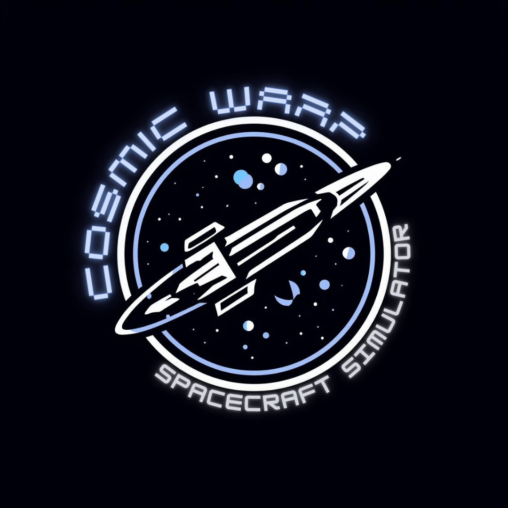

# COSMIC WARP

<div class="cw-hero" markdown>



**GPU-parallel spacecraft dynamics on [NVIDIA Warp](https://github.com/NVIDIA/warp).**
Thousands to millions of spacecraft step in parallel, in float64, with each
`simulate()` loop replayed as one CUDA graph.

```bash
pip install cosmic-warp
```

</div>

COSMIC WARP is the simulator, not the application. Guidance, control and
training algorithms are yours; the simulator gives them a batched,
on-device spacecraft model to run against.

## What you get

- **6-DOF dynamics with variable mass** — orbit and attitude in float64,
  point-mass gravity, J2, atmospheric drag, gravity-gradient and magnetic
  torques, each switched on or off. Euler, RK4 (default) and a symplectic
  kick–drift–kick integrator.
- **Actuators** — up to 8 thrusters with propellant use and 4 reaction wheels
  with friction and momentum saturation per spacecraft.
- **Batches on the device** — environments with one or several spacecraft,
  sampled resets, domain randomization and termination, all inside the
  captured step: no host round trip in the loop.
- **Scenarios in YAML** — a whole scenario in one strictly checked file.
- **Learning** — a vectorized [RL environment](guides/rl.md) with adapters for
  rsl_rl, skrl and rl_games, and [differentiable rollouts](guides/differentiable.md)
  with gradients for initial states, controls and vehicle parameters.
- **Evidence** — the physics is tested against analytic solutions: Kepler
  orbits, J2 secular rates, torque-free rotation, Hohmann transfers,
  Tsiolkovsky burns, Clohessy–Wiltshire motion. See [Validation](validation/index.md).

Earth is the only central body, and the field and atmosphere models are
simple ones; [Physics models](guides/physics.md) states what is modelled and
the [Roadmap](roadmap.md) what is planned. Version 0.1 is a beta: the API may
change before 1.0.

## Where to start

<div class="grid cards" markdown>

-   :material-rocket-launch-outline:{ .lg .middle } **Getting started**

    ---

    Install, propagate a batch of spacecraft, fire a thruster, load a YAML
    scenario.

    [:material-arrow-right: Start here](getting-started.md)

-   :material-book-open-variant:{ .lg .middle } **Guides**

    ---

    One task per page: vehicles, actuators, resets, randomization, physics,
    integrators, scaling, RL and gradients.

    [:material-arrow-right: Browse the guides](guides/index.md)

-   :material-file-code-outline:{ .lg .middle } **Examples**

    ---

    Seventeen runnable scripts, from a basic orbit to Monte Carlo campaigns,
    gradient-based optimization and RL training.

    [:material-arrow-right: Browse examples](examples/index.md)

-   :material-check-decagram-outline:{ .lg .middle } **Validation**

    ---

    Every physics claim with the test that checks it, against analytic
    solutions.

    [:material-arrow-right: See the evidence](validation/index.md)

-   :material-function-variant:{ .lg .middle } **Theory**

    ---

    The equations behind the kernels, and the frames, state and units every
    number follows.

    [:material-arrow-right: Read the theory](theory/index.md)

-   :material-api:{ .lg .middle } **API reference**

    ---

    Generated from the docstrings of every module in `cosmic_warp`.

    [:material-arrow-right: Open the reference](reference/api/cosmic_warp/index.md)

</div>
